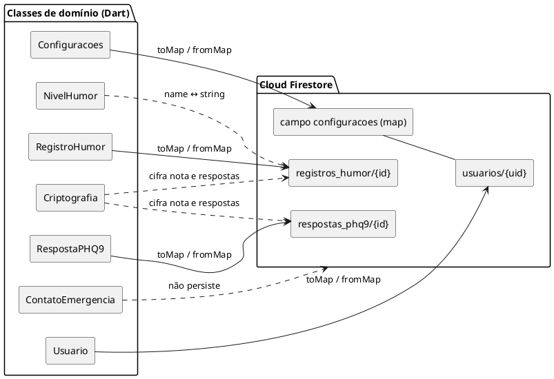

# Projeto Unidade II: Mapeamento das Classes Dart para o Firestore
 
Projeto Respira, aplicativo de saúde mental e apoio emocional
Disciplina: Programação para Dispositivos Móveis | Projeto da Unidade II, Questão 01 b) iv) (parte de 2,0 pontos)
 
| Campo | Preenchimento |
|---|---|
| Seção | Modelagem do Banco de Dados, mapeamento das classes de domínio Dart para o Firestore (Q1 b) iv) |
| Autor desta seção | Rene Mendonça Marinho |
| Sprint | Sprint 2 (10/11/2026 a 16/11/2026) |
| Base | docs/diagrama-classes.md (classes e métodos toMap()/fromMap()) e docs/modelagem-firestore.md (coleções, campos e Security Rules) |
 
Este documento liga as duas pontas: as classes de domínio definidas em docs/diagrama-classes.md e os documentos definidos em docs/modelagem-firestore.md. Para cada classe, mostra onde ela é gravada, como cada atributo vira um campo e qual conversão acontece no caminho.
 
## 1. Visão geral
 
| Classe Dart | Onde fica no Firestore | Identificador | Conversão |
|---|---|---|---|
| Usuario | Documento usuarios/{uid} | uid = id do documento | toMap() / fromMap(uid, dados) |
| Configuracoes | Campo de mapa configuracoes dentro de usuarios/{uid} | Não tem id próprio | toMap() / fromMap(dados) |
| RegistroHumor | Documento em usuarios/{uid}/registros_humor/{id} | id = id do documento | toMap() / fromMap(id, dados) |
| NivelHumor | Campo humor (string) em registros_humor | — | humor.name / NivelHumor.values.byName(...) |
| RespostaPHQ9 | Documento em usuarios/{uid}/respostas_phq9/{id} | id = id do documento | toMap() / fromMap(id, dados) |
| ContatoEmergencia | *Não é gravado* | — | Constante no código (RF10, RN08) |
| Criptografia | *Não é gravada* | — | Serviço usado dentro de toMap() e fromMap() |
 


Representação visual feita no site [PlantText](https://www.planttext.com/). Versão renderizada: [`docs/mapeamento-dart-firestore.pdf`](mapeamento-dart-firestore.pdf).

## 2. Regras gerais de conversão
 
| Tipo em Dart | Tipo no Firestore | Como converte | Motivo |
|---|---|---|---|
| String id / String uid | id do documento | Lido de snapshot.id; nunca gravado como campo | Evita guardar o mesmo valor duas vezes. |
| DateTime | timestamp | Timestamp.fromDate(data) / (valor as Timestamp).toDate() | O Firestore ordena timestamp nativamente (consultas da seção 6 da modelagem). |
| enum (NivelHumor) | string | humor.name / NivelHumor.values.byName(texto) | O nome é legível no console e não muda se a ordem do enum mudar. |
| bool | boolean | Direto | — |
| int | number | Direto | — |
| String? sensível (nota) | string ou null | Criptografia.cifrar ao gravar / decifrar ao ler | RF12, RN06. |
| `List<int>` sensível (respostas) | string | jsonEncode → cifrar ao gravar / decifrar → jsonDecode ao ler | A lista inteira vira um único texto cifrado (RF12). |
| Objeto 1 para 1 (Configuracoes) | map | configuracoes.toMap() dentro do documento do usuário | Composição 1 para 1 no diagrama de classes. |
 
O nome do campo no Firestore é o mesmo do atributo Dart, exceto nos campos cifrados, que recebem o sufixo Cifrada/Cifradas para deixar claro no banco que o conteúdo não é legível.
 
## 3. Mapeamento campo a campo
 
### 3.1 Usuario → usuarios/{uid}
 
| Atributo Dart | Tipo Dart | Campo no Firestore | Tipo no Firestore | Conversão |
|---|---|---|---|---|
| uid | String | id do documento | string | snapshot.id |
| anonimo | bool | anonimo | boolean | Direto; passa a false no cadastro |
| email | String? | *Não é gravado* | — | Lido de FirebaseAuth.instance.currentUser?.email (fica só no Firebase Authentication) |
| nomeUsuario | String? | nomeUsuario | string ou null | Direto; só para usuário cadastrado |
| fotoPerfil | String? | fotoPerfil | string ou null | Foto reduzida no aparelho e convertida em Base64 |
| criadoEm | DateTime | criadoEm | timestamp | Timestamp.fromDate / toDate() |
| — | — | configuracoes | map | Gravado junto na criação com Configuracoes().toMap() |
 
### 3.2 Configuracoes → campo configuracoes de usuarios/{uid}
 
| Atributo Dart | Tipo Dart | Campo no Firestore | Tipo no Firestore | Conversão |
|---|---|---|---|---|
| temaEscuro | bool | configuracoes.temaEscuro | boolean | Direto |
| notificacoesAtivas | bool | configuracoes.notificacoesAtivas | boolean | Direto |
 
### 3.3 RegistroHumor → usuarios/{uid}/registros_humor/{id}
 
| Atributo Dart | Tipo Dart | Campo no Firestore | Tipo no Firestore | Conversão |
|---|---|---|---|---|
| id | String | id do documento | string | snapshot.id |
| humor | NivelHumor | humor | string | humor.name / NivelHumor.values.byName |
| nota | String? | notaCifrada | string ou null | cifrar / decifrar; null continua null |
| criadoEm | DateTime | criadoEm | timestamp | Timestamp.fromDate / toDate() |
 
### 3.4 RespostaPHQ9 → usuarios/{uid}/respostas_phq9/{id}
 
| Atributo Dart | Tipo Dart | Campo no Firestore | Tipo no Firestore | Conversão |
|---|---|---|---|---|
| id | String | id do documento | string | snapshot.id |
| respostas | `List<int>` | respostasCifradas | string | jsonEncode + cifrar / decifrar + jsonDecode |
| escore | int | escore | number | Direto; calculado por calcularEscore() antes de gravar |
| respondidoEm | DateTime | respondidoEm | timestamp | Timestamp.fromDate / toDate() |
 
## 4. Implementação de referência em Dart
 
O código abaixo é uma implementação de referência: mostra como os métodos toMap() e fromMap() do diagrama de classes devem ficar quando o app for implementado, a partir da Sprint 3 (docs/sprints.md, seção 5). Ele ainda não existe no código-fonte do app. Os demais métodos de cada classe foram omitidos. O serviço Criptografia é acessado por uma instância única (Criptografia.instancia), já que o diagrama define cifrar e decifrar como métodos de instância.

Os atributos são privados, como no diagrama de classes (marcador `-`). Em Dart, isso corresponde ao prefixo `_` no nome do campo, com um getter público só de leitura para cada atributo. As tabelas da seção 3 usam o nome do atributo sem o `_`.
 
### 4.1 RegistroHumor
 
```dart
import 'package:cloud_firestore/cloud_firestore.dart';
 
enum NivelHumor { muitoMal, mal, neutro, bem, muitoBem }
 
class RegistroHumor {
  RegistroHumor({
    required String id,
    required NivelHumor humor,
    String? nota,
    required DateTime criadoEm,
  })  : _id = id,
        _humor = humor,
        _nota = nota,
        _criadoEm = criadoEm;
 
  final String _id;
  final NivelHumor _humor;
  final String? _nota;
  final DateTime _criadoEm;
 
  String get id => _id;
  NivelHumor get humor => _humor;
  String? get nota => _nota;
  DateTime get criadoEm => _criadoEm;
 
  Map<String, dynamic> toMap() => {
        'humor': _humor.name,
        'notaCifrada':
            _nota == null ? null : Criptografia.instancia.cifrar(_nota),
        'criadoEm': Timestamp.fromDate(_criadoEm),
      };
 
  static RegistroHumor fromMap(String id, Map<String, dynamic> dados) {
    final notaCifrada = dados['notaCifrada'] as String?;
    return RegistroHumor(
      id: id,
      humor: NivelHumor.values.byName(dados['humor'] as String),
      nota: notaCifrada == null
          ? null
          : Criptografia.instancia.decifrar(notaCifrada),
      criadoEm: (dados['criadoEm'] as Timestamp).toDate(),
    );
  }
}
```
 
### 4.2 RespostaPHQ9
 
```dart
import 'dart:convert';
import 'package:cloud_firestore/cloud_firestore.dart';
 
class RespostaPHQ9 {
  RespostaPHQ9({
    required String id,
    required List<int> respostas,
    required int escore,
    required DateTime respondidoEm,
  })  : _id = id,
        _respostas = respostas,
        _escore = escore,
        _respondidoEm = respondidoEm;
 
  final String _id;
  final List<int> _respostas;
  final int _escore;
  final DateTime _respondidoEm;
 
  String get id => _id;
  List<int> get respostas => List.unmodifiable(_respostas);
  int get escore => _escore;
  DateTime get respondidoEm => _respondidoEm;
 
  Map<String, dynamic> toMap() => {
        'respostasCifradas':
            Criptografia.instancia.cifrar(jsonEncode(_respostas)),
        'escore': _escore,
        'respondidoEm': Timestamp.fromDate(_respondidoEm),
      };
 
  static RespostaPHQ9 fromMap(String id, Map<String, dynamic> dados) {
    final texto = Criptografia.instancia
        .decifrar(dados['respostasCifradas'] as String);
    return RespostaPHQ9(
      id: id,
      respostas: List<int>.from(jsonDecode(texto) as List),
      escore: dados['escore'] as int,
      respondidoEm: (dados['respondidoEm'] as Timestamp).toDate(),
    );
  }
}
```
 
### 4.3 Usuario e Configuracoes
 
```dart
import 'package:cloud_firestore/cloud_firestore.dart';
 
class Configuracoes {
  Configuracoes({bool temaEscuro = false, bool notificacoesAtivas = false})
      : _temaEscuro = temaEscuro,
        _notificacoesAtivas = notificacoesAtivas;
 
  bool _temaEscuro;
  bool _notificacoesAtivas;
 
  bool get temaEscuro => _temaEscuro;
  bool get notificacoesAtivas => _notificacoesAtivas;
 
  Map<String, dynamic> toMap() => {
        'temaEscuro': _temaEscuro,
        'notificacoesAtivas': _notificacoesAtivas,
      };
 
  static Configuracoes fromMap(Map<String, dynamic> dados) => Configuracoes(
        temaEscuro: dados['temaEscuro'] as bool? ?? false,
        notificacoesAtivas: dados['notificacoesAtivas'] as bool? ?? false,
      );
}
 
class Usuario {
  Usuario({
    required String uid,
    required bool anonimo,
    String? email,
    String? nomeUsuario,
    String? fotoPerfil,
    required DateTime criadoEm,
  })  : _uid = uid,
        _anonimo = anonimo,
        _email = email,
        _nomeUsuario = nomeUsuario,
        _fotoPerfil = fotoPerfil,
        _criadoEm = criadoEm;
 
  final String _uid;
  final bool _anonimo;
  final String? _email; // vem do Firebase Authentication, não do Firestore
  final String? _nomeUsuario;
  final String? _fotoPerfil;
  final DateTime _criadoEm;
 
  String get uid => _uid;
  bool get anonimo => _anonimo;
  String? get email => _email;
  String? get nomeUsuario => _nomeUsuario;
  String? get fotoPerfil => _fotoPerfil;
  DateTime get criadoEm => _criadoEm;
 
  Map<String, dynamic> toMap() => {
        'anonimo': _anonimo,
        'criadoEm': Timestamp.fromDate(_criadoEm),
        'configuracoes': Configuracoes().toMap(),
        'nomeUsuario': _nomeUsuario,
        'fotoPerfil': _fotoPerfil,
      };
 
  static Usuario fromMap(String uid, Map<String, dynamic> dados,
          {String? email}) =>
      Usuario(
        uid: uid,
        anonimo: dados['anonimo'] as bool,
        email: email,
        nomeUsuario: dados['nomeUsuario'] as String?,
        fotoPerfil: dados['fotoPerfil'] as String?,
        criadoEm: (dados['criadoEm'] as Timestamp).toDate(),
      );
}
```
 
Usuario.toMap() só é usado na criação do documento, no primeiro acesso ou no cadastro direto. Depois disso, as Security Rules só permitem alterar configuracoes, anonimo, nomeUsuario e fotoPerfil (docs/modelagem-firestore.md, seção 7).
 
## 5. Ligando as classes às coleções
 
O withConverter do pacote cloud_firestore faz o Firestore devolver objetos Dart em vez de mapas, usando os mesmos toMap() e fromMap():
 
```dart
import 'package:cloud_firestore/cloud_firestore.dart';
 
class ColecoesRespira {
  ColecoesRespira(this.uid);
 
  final String uid;
  final _db = FirebaseFirestore.instance;
 
  DocumentReference<Map<String, dynamic>> get usuario =>
      _db.collection('usuarios').doc(uid);
 
  CollectionReference<RegistroHumor> get registrosHumor => usuario
      .collection('registros_humor')
      .withConverter<RegistroHumor>(
        fromFirestore: (snap, _) => RegistroHumor.fromMap(snap.id, snap.data()!),
        toFirestore: (registro, _) => registro.toMap(),
      );
 
  CollectionReference<RespostaPHQ9> get respostasPhq9 => usuario
      .collection('respostas_phq9')
      .withConverter<RespostaPHQ9>(
        fromFirestore: (snap, _) => RespostaPHQ9.fromMap(snap.id, snap.data()!),
        toFirestore: (resposta, _) => resposta.toMap(),
      );
}
```
 
Exemplos de uso por caso de uso:
 
| Caso de uso | Chamada |
|---|---|
| UC02 Registrar humor | colecoes.registrosHumor.add(registro) |
| UC03 Consultar histórico | colecoes.registrosHumor.orderBy('criadoEm', descending: true).snapshots() |
| UC04 Excluir registro | colecoes.registrosHumor.doc(registro.id).delete() |
| UC06 Responder PHQ-9 | colecoes.respostasPhq9.add(resposta) |
| UC08 Ver evolução | colecoes.respostasPhq9.orderBy('respondidoEm').snapshots() |
| UC10 e UC11 Configurações | colecoes.usuario.update({'configuracoes': configuracoes.toMap()}) |
| UC15 Criar conta (vindo do uso anônimo) | FirebaseAuth.instance.currentUser!.linkWithCredential(EmailAuthProvider.credential(email: email, password: senha)), depois getIdToken(true) e colecoes.usuario.update({'anonimo': false}) |
| UC16 Entrar com e-mail e senha | FirebaseAuth.instance.signInWithEmailAndPassword(email: email, password: senha) |
| UC17 Recuperar senha | FirebaseAuth.instance.sendPasswordResetEmail(email: email) |
| UC18 Editar perfil | colecoes.usuario.update({'nomeUsuario': nome, 'fotoPerfil': fotoBase64}) |
 
Na criação, o id ainda não existe, porque o Firestore só o gera no add. O objeto é criado com id: '', e o valor correto chega na leitura, pelo snapshot.id.
 
## 6. Comportamento offline no mapeamento
 
- add, update e delete gravam primeiro no cache local e retornam sem esperar a rede (RF16, RN05). Por isso as datas vêm de DateTime.now() no aparelho, e não de FieldValue.serverTimestamp(), que ficaria vazio até a sincronização.
- snapshots() entrega os dados do cache imediatamente e atualiza quando o servidor responde. A tela de histórico funciona em modo avião.
- Criptografia roda no aparelho e não depende de rede, então cifrar e decifrar funcionam offline.
- Cadastro, login e recuperação de senha dependem do Firebase Authentication e precisam de internet (RN15). Como linkWithCredential mantém o mesmo uid, o cadastro não move nenhum documento: os dados anônimos continuam em usuarios/{uid} (RN19).
 
## 7. Coerência com os outros documentos
 
| Verificação | Documento |
|---|---|
| Nomes de classes, atributos e métodos iguais aos do diagrama | docs/diagrama-classes.md |
| Nomes de coleções, campos e tipos iguais aos da modelagem | docs/modelagem-firestore.md |
| Campos que as Security Rules validam (humor, escore, datas) recebem exatamente os tipos que as regras esperam | docs/modelagem-firestore.md, seção 7 |
| RegistroHumor e RespostaPHQ9 não têm conversão para atualização, porque não podem ser editados | docs/diagrama-casos-de-uso.md, RN03 e RN04 |
 
Humor e escore ficam sem cifra, porque são os dados que o usuário revisita no histórico e no gráfico. Essa decisão está registrada em docs/modelagem-firestore.md, seção 9, e em docs/regras-de-negocio.md (RN10).
 