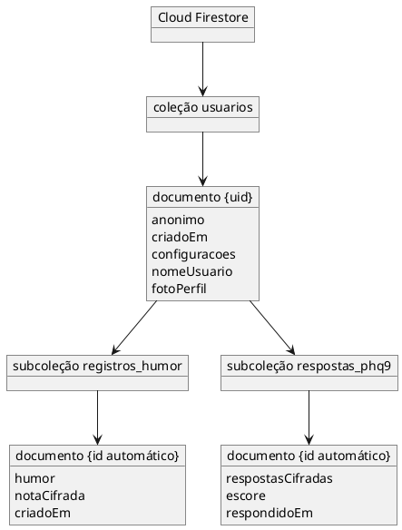

# Projeto Unidade II: Modelagem do Banco de Dados no Firestore
 
_Projeto Respira, aplicativo de saúde mental e apoio emocional_
Disciplina: Programação para Dispositivos Móveis | Projeto da Unidade II, Questão 01 b) iii) (parte de 2,0 pontos)
 
| Campo | Preenchimento |
|---|---|
| Seção | Modelagem do Banco de Dados, estrutura de coleções e documentos no Firebase (Q1 b) iii) |
| Autor desta seção | Rafael Menezes Gonçalves |
| Sprint | Sprint 2 (10/11/2026 a 16/11/2026) |
| Base | `docs/diagrama-classes.md`, `docs/diagrama-casos-de-uso.md` (regras RN01 a RN08), `docs/requisitos.md` (CRUD, seção 4) e `docs/escopo.md` (escopo técnico) |
 
Este documento define como os dados do Respira ficam organizados no Cloud Firestore: coleções, documentos, campos, tipos, consultas e regras de acesso. A correspondência campo a campo com as classes Dart está em `docs/mapeamento-dart-firestore.md` (Q1 b) iv).
 
## 1. Decisões de modelagem
 
| Decisão | Motivo |
|---|---|
| Tudo fica abaixo de `usuarios/{uid}` | O `uid` vem da conta do Firebase Authentication, anônima (RF17) ou cadastrada (RF18). Como o cadastro vincula a conta anônima à nova conta, o `uid` não muda e os dados continuam no mesmo lugar (RN19). Agrupar por usuário permite que as Security Rules isolem cada pessoa com uma única regra (RN02, RNF03). |
| Diário e PHQ-9 em subcoleções | São listas que crescem com o tempo (composição 1 para 0..* no diagrama de classes). Em subcoleção, cada registro é um documento pequeno, consultável e excluível sozinho (RF04). |
| Configurações como campo de mapa no documento do usuário | A relação é 1 para 1 no diagrama de classes. Um mapa dentro de `usuarios/{uid}` evita uma leitura extra ao abrir o app. |
| Número do CVV fora do banco | É constante no código (`ContatoEmergencia`) e precisa discar sem rede (RF10, RN08). |
| Mínimo de dados pessoais | Não existe campo de e-mail, telefone ou localização. O e-mail do usuário cadastrado fica só no Firebase Authentication. Nome de usuário e foto são opcionais e só existem para quem se cadastrou (RN01, RN20, RNF03). |
| Foto de perfil dentro do documento do usuário | A foto é reduzida no aparelho (até 256 × 256 px, JPEG) e gravada como texto Base64 no campo `fotoPerfil`. Isso evita depender do Cloud Storage, que exige o plano pago (Blaze) em projetos novos do Firebase, e a foto é apagada junto com o documento no Botão de Pânico (RF20). |
| Campos sensíveis cifrados no aparelho | Nota do diário e respostas do PHQ-9 chegam ao Firestore já cifradas (RF12, RN06). |
| Datas geradas no aparelho, não pelo servidor | Com persistência offline, um registro criado sem rede precisa da data na hora em que foi criado. A data do servidor só existiria depois da sincronização (RF16, RN05). |
| Nomes de coleção em snake_case e campos em camelCase | Coleções ficam legíveis em português; os campos seguem o mesmo nome dos atributos Dart, o que simplifica o mapeamento. |
 
## 2. Estrutura de coleções e documentos
 


Usado o site para representação visual: [PlantText](https://www.planttext.com/). Versão renderizada: [`docs/modelagem-firestore.pdf`](modelagem-firestore.pdf).
 
Em forma de caminho:
 
```text
usuarios/{uid}
  ├─ registros_humor/{registroId}
  └─ respostas_phq9/{respostaId}
```
 
## 3. Documentos e campos
 
### 3.1 `usuarios/{uid}`
 
| Campo | Tipo no Firestore | Obrigatório | Exemplo | Observação |
|---|---|---|---|---|
| (id do documento) | string | Sim | `Xk2...9aQ` | É o `uid` da conta (anônima ou cadastrada). Não é repetido como campo. |
| `anonimo` | boolean | Sim | `true` | `true` enquanto o usuário não se cadastra; passa a `false` no cadastro (RN19). |
| `criadoEm` | timestamp | Sim | `2026-11-17T09:12:00-03:00` | Data do primeiro acesso. |
| `configuracoes` | map | Sim | ver abaixo | Preferências do usuário. |
| `configuracoes.temaEscuro` | boolean | Sim | `false` | RF15. Padrão `false`. |
| `configuracoes.notificacoesAtivas` | boolean | Sim | `false` | RF14. Padrão `false`, para que nenhuma notificação apareça sem o usuário pedir. |
| `nomeUsuario` | string ou null | Não | `Lu` | Opcional, até 40 caracteres, só para usuário cadastrado (RF20). |
| `fotoPerfil` | string ou null | Não | `/9j/4AAQ...` | Foto reduzida em Base64, opcional, só para usuário cadastrado (RF20). |
 
### 3.2 `usuarios/{uid}/registros_humor/{registroId}`
 
| Campo | Tipo no Firestore | Obrigatório | Exemplo | Observação |
|---|---|---|---|---|
| (id do documento) | string | Sim | gerado pelo Firestore | Usado para excluir um registro (RF04). |
| `humor` | string | Sim | `bem` | Um dos cinco valores: `muitoMal`, `mal`, `neutro`, `bem`, `muitoBem` (RF01). |
| `notaCifrada` | string ou null | Não | `q8F...==` | Nota opcional de até 10.000 caracteres (RF02, RN16), cifrada no aparelho. `null` quando não houver nota. |
| `criadoEm` | timestamp | Sim | `2026-11-18T22:40:00-03:00` | Data e hora do registro (RF01). |
 
### 3.3 `usuarios/{uid}/respostas_phq9/{respostaId}`
 
| Campo | Tipo no Firestore | Obrigatório | Exemplo | Observação |
|---|---|---|---|---|
| (id do documento) | string | Sim | gerado pelo Firestore | Um documento por aplicação semanal. |
| `respostasCifradas` | string | Sim | `Z1c...==` | As nove respostas (0 a 3), cifradas no aparelho (RF06, RF12). |
| `escore` | number (inteiro) | Sim | `11` | Soma das respostas, de 0 a 27 (RF07). Usado no gráfico (RF08). |
| `respondidoEm` | timestamp | Sim | `2026-11-23T20:05:00-03:00` | Data da aplicação. |
 
## 4. Exemplo de documentos
 
```jsonc
// usuarios/Xk2...9aQ
{
  "anonimo": false,
  "criadoEm": "2026-11-17T09:12:00-03:00",
  "configuracoes": { "temaEscuro": true, "notificacoesAtivas": false },
  "nomeUsuario": "Lu",
  "fotoPerfil": null
}
 
// usuarios/Xk2...9aQ/registros_humor/7Hc...p2
{
  "humor": "neutro",
  "notaCifrada": "q8F...==",
  "criadoEm": "2026-11-18T22:40:00-03:00"
}
 
// usuarios/Xk2...9aQ/respostas_phq9/Lm4...t9
{
  "respostasCifradas": "Z1c...==",
  "escore": 11,
  "respondidoEm": "2026-11-23T20:05:00-03:00"
}
```
 
Os valores de exemplo são fictícios. No Firestore, as datas são do tipo timestamp; aqui aparecem como texto só para leitura.
 
## 5. Operações (CRUD) por coleção
 
| Coleção | Criar | Ler | Atualizar | Excluir | Regra |
|---|---|---|---|---|---|
| `usuarios/{uid}` | No primeiro acesso ou no cadastro (UC01, UC15) | Ao abrir o app | `configuracoes` (UC10, UC11), `anonimo` no cadastro (UC15) e perfil (UC18) | Só pelo Botão de Pânico (UC12) | RN01, RN02, RN19, RN20 |
| `registros_humor` | UC02 | UC03 | Nunca | Individual (UC04) ou total (UC12) | RN03 |
| `respostas_phq9` | UC06 | UC08 | Nunca | Só total, pelo Botão de Pânico (UC12) | RN04 |
 
Esta tabela é a mesma de `docs/requisitos.md`, seção 4, aplicada às coleções.

Depois do cadastro, o app força a renovação do token de autenticação (`getIdToken(true)`) antes de gravar `anonimo: false`, para que as Security Rules já enxerguem a sessão como cadastrada.
 
## 6. Consultas
 
| Tela | Consulta | Índice |
|---|---|---|
| Tela 03, histórico do diário | `registros_humor` ordenada por `criadoEm`, decrescente | Índice simples, criado automaticamente pelo Firestore |
| Tela 06, gráfico do PHQ-9 | `respostas_phq9` ordenada por `respondidoEm`, crescente | Índice simples, criado automaticamente pelo Firestore |
| Abertura do app | Leitura direta de `usuarios/{uid}` | Não precisa de índice |
 
Nenhuma consulta filtra por mais de um campo, então o projeto não precisa de índice composto.
 
## 7. Regras de segurança (Security Rules)
 
```javascript
rules_version = '2';
service cloud.firestore {
  match /databases/{database}/documents {
 
    function dono(uid) {
      return request.auth != null && request.auth.uid == uid;
    }
 
    function sessaoAnonima() {
      return request.auth.token.firebase.sign_in_provider == 'anonymous';
    }
 
    function perfilValido(d) {
      return (d.get('nomeUsuario', null) == null
                || (d.nomeUsuario is string && d.nomeUsuario.size() <= 40))
          && (d.get('fotoPerfil', null) == null
                || (d.fotoPerfil is string && d.fotoPerfil.size() <= 150000))
          && (d.anonimo == false
                || (d.get('nomeUsuario', null) == null && d.get('fotoPerfil', null) == null));
    }
 
    match /usuarios/{uid} {
      allow read, delete: if dono(uid);
      allow create: if dono(uid)
        && request.resource.data.anonimo == sessaoAnonima()
        && request.resource.data.configuracoes.temaEscuro is bool
        && request.resource.data.configuracoes.notificacoesAtivas is bool
        && perfilValido(request.resource.data);
      allow update: if dono(uid)
        && request.resource.data.diff(resource.data).affectedKeys()
             .hasOnly(['configuracoes', 'anonimo', 'nomeUsuario', 'fotoPerfil'])
        && request.resource.data.anonimo == sessaoAnonima()
        && perfilValido(request.resource.data);
 
      match /registros_humor/{registroId} {
        allow read, delete: if dono(uid);
        allow create: if dono(uid)
          && request.resource.data.humor in ['muitoMal', 'mal', 'neutro', 'bem', 'muitoBem']
          && request.resource.data.criadoEm is timestamp
          && (request.resource.data.notaCifrada == null
              || (request.resource.data.notaCifrada is string
                  && request.resource.data.notaCifrada.size() <= 60000));
        allow update: if false;
      }
 
      match /respostas_phq9/{respostaId} {
        allow read, delete: if dono(uid);
        allow create: if dono(uid)
          && request.resource.data.respostasCifradas is string
          && request.resource.data.escore is int
          && request.resource.data.escore >= 0
          && request.resource.data.escore <= 27
          && request.resource.data.respondidoEm is timestamp;
        allow update: if false;
      }
    }
 
    match /{documento=**} {
      allow read, write: if false;
    }
  }
}
```
 
| Trecho | O que garante |
|---|---|
| `dono(uid)` | Só a própria conta, anônima ou cadastrada, lê e grava os seus dados (RN02, RNF03). |
| `anonimo == sessaoAnonima()` | O campo `anonimo` sempre reflete o tipo real da sessão; só passa a `false` depois do cadastro (RN19). |
| `perfilValido()` | Nome de usuário até 40 caracteres, foto reduzida até cerca de 110 KB e perfil só para usuário cadastrado (RN20). |
| Limite de 60.000 em `notaCifrada` | Comporta a nota de até 10.000 caracteres (RN16) depois de cifrada e convertida em Base64, mesmo com acentos e emojis. |
| `update` no usuário restrito a `configuracoes`, `anonimo` e perfil | Não dá para alterar `criadoEm` depois de criado. |
| `allow update: if false` no diário e no PHQ-9 | Registros e respostas não podem ser editados (RN03, RN04). |
| Validação de humor, escore e datas | O banco recusa dados fora do formato, mesmo que o app tenha erro (validações de Q1 a) iv). |
| Regra final `/{documento=**}` | Qualquer caminho fora de `usuarios/{uid}` é negado. |
 
A regra de `delete` em `respostas_phq9` existe só para que o Botão de Pânico consiga apagar tudo. O app não oferece exclusão individual de respostas (RN04); essa restrição fica na interface, porque as Security Rules não distinguem de qual tela veio o pedido.
 
## 8. Exclusão total pelo Botão de Pânico
 
O Firestore não apaga subcoleções quando o documento pai é apagado. Por isso o Botão de Pânico (UC12, RF13) segue esta ordem:
 
1. Apaga os dados locais do aparelho, sem esperar a nuvem (RN07).
2. Apaga todos os documentos de `registros_humor` e `respostas_phq9` do usuário.
3. Apaga o documento `usuarios/{uid}`.
4. Exclui a conta no Firebase Authentication. Para usuário cadastrado, o Firebase exige um login recente; por isso o app pede a senha de novo antes de excluir (RN07).
 
Se não houver internet, os passos 2 e 3 ficam na fila do Firestore e são enviados quando a conexão voltar. O passo 4 depende de rede; até lá, a conta fica sem dados (RN15).
 
## 9. Decisão sobre criptografia
 
A nota do diário e as respostas do PHQ-9 são cifradas no aparelho antes do envio. O nível de humor e o escore ficam sem cifra no banco, protegidos pelas Security Rules (só a própria conta lê), porque são os dados que o usuário revisita no histórico do diário (Tela 03) e no gráfico de evolução do PHQ-9 (Tela 06). A decisão foi tomada pelo grupo e está registrada em `docs/regras-de-negocio.md` (RN10), em `docs/requisitos.md` (RF12) e em `docs/mapeamento-dart-firestore.md`.
